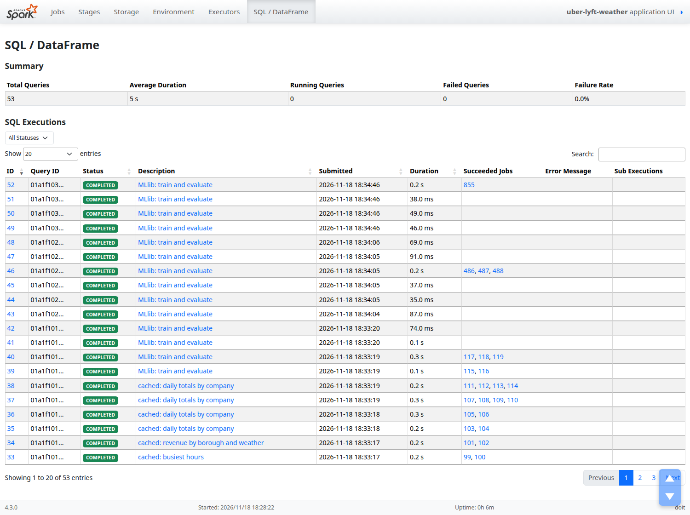
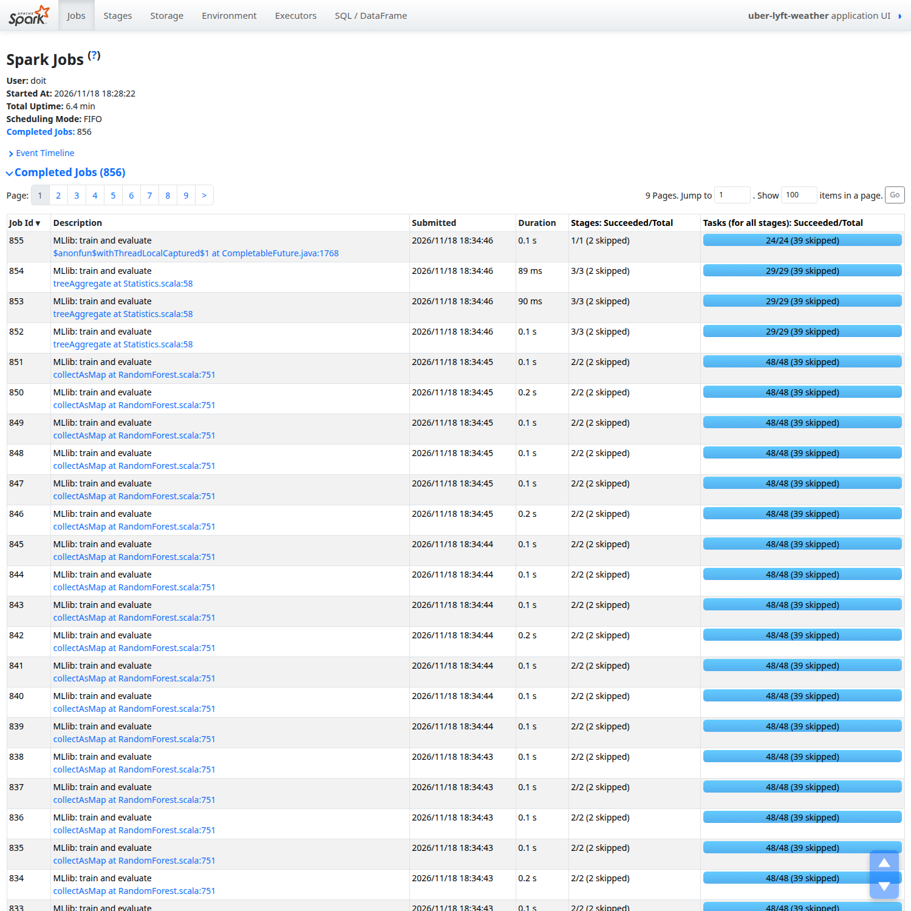
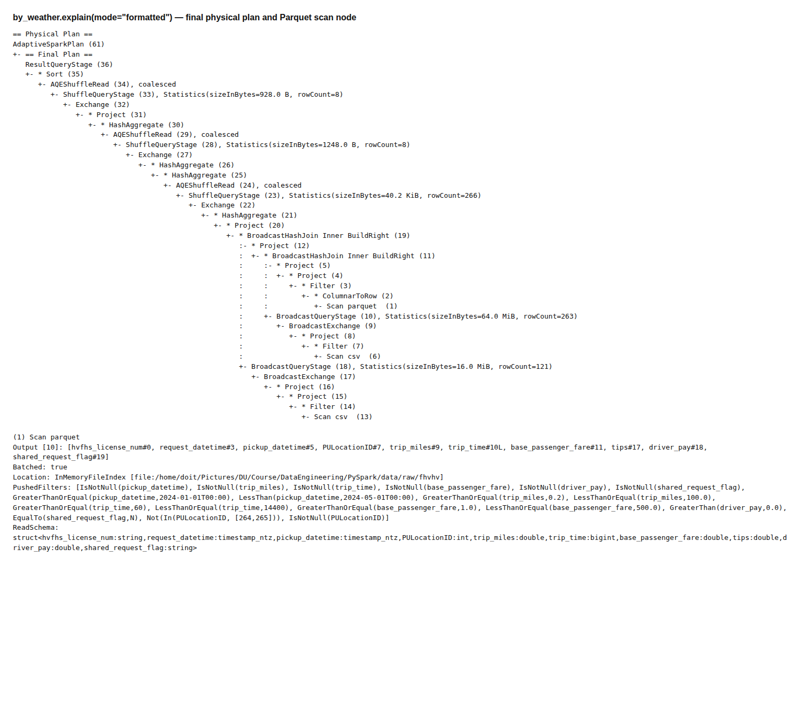
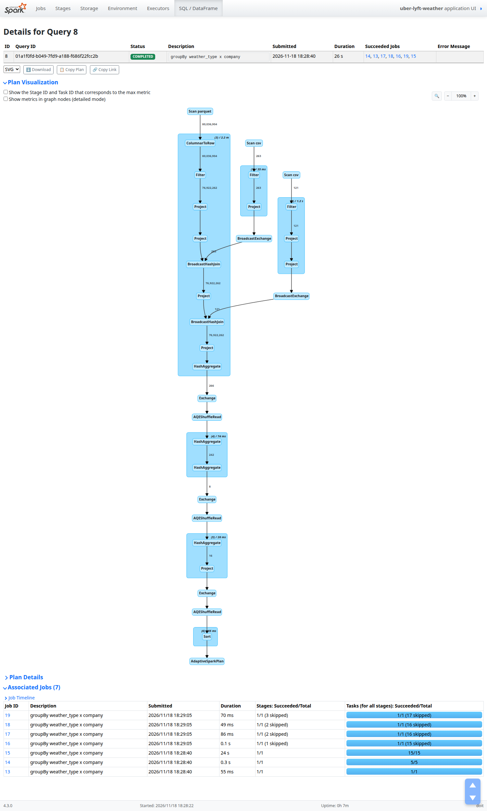
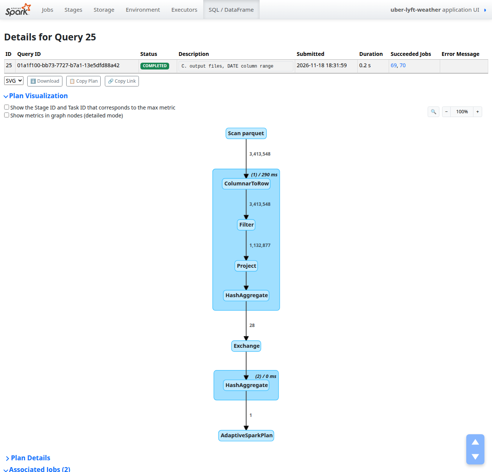
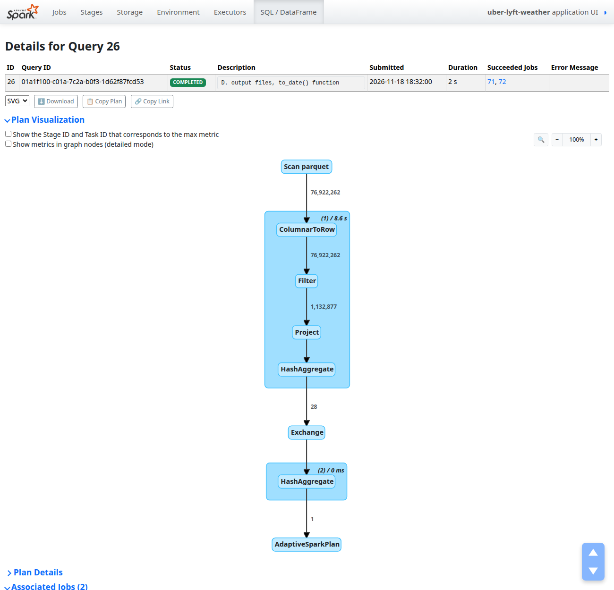
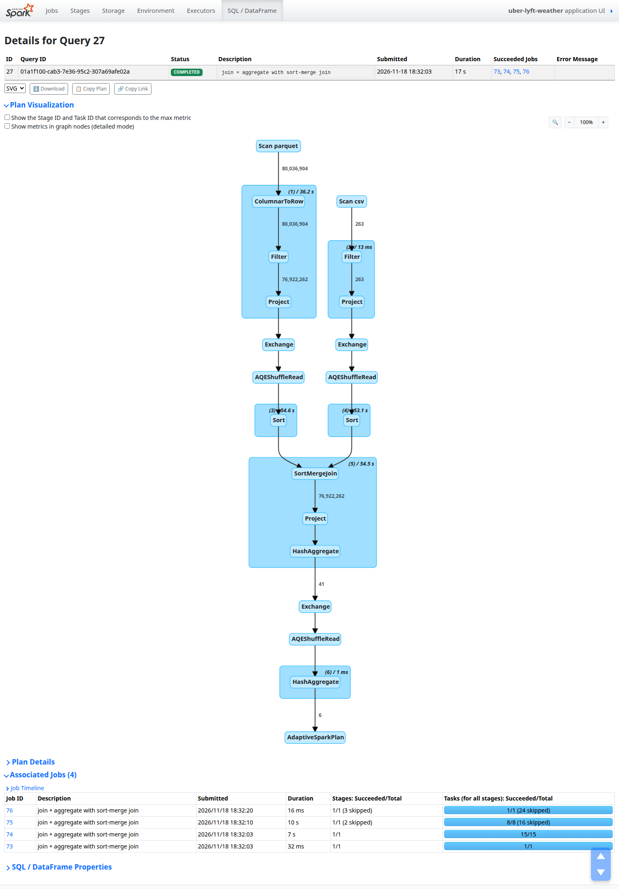

# Rain, Cold and Ride-Hailing: a PySpark pipeline on 80M Uber/Lyft trips

A PySpark pipeline that joins four months of New York City Uber and Lyft trips to daily weather and asks: **how does weather change ride-hailing demand, prices, waiting time and driver pay, and does it hit Uber and Lyft differently?**

| File | What it is |
|---|---|
| [`uber_lyft_weather_pipeline.ipynb`](uber_lyft_weather_pipeline.ipynb) | The executed notebook (all outputs included) |
| [`uber_lyft_weather_pipeline.html`](uber_lyft_weather_pipeline.html) | HTML export of the same notebook |
| [`pipeline.py`](pipeline.py) | The same code as a plain Python script (Jupytext percent format) |
| [`screenshots/`](screenshots) | Spark UI Query Details, execution plan and run screenshots |

## Dataset

| Dataset | Source | Format | Size |
|---|---|---|---|
| High Volume For-Hire Vehicle trip records, Jan-Apr 2024 | [NYC Taxi & Limousine Commission](https://www.nyc.gov/site/tlc/about/tlc-trip-record-data.page) | 4 Parquet files | 80,036,904 rows, 24 columns, 1.83 GB compressed |
| Taxi zone lookup | NYC TLC | CSV | 265 zones |
| Daily weather, Central Park (station USW00094728) | [NOAA GHCN-Daily](https://www.ncei.noaa.gov/products/land-based-station/global-historical-climatology-network-daily) | CSV | 1 row per day, 121 days used |

The trip records cover every Uber (`HV0003`) and Lyft (`HV0005`) trip in the city: request, pickup and drop-off times, pickup and drop-off zone, miles, duration, passenger fare, tips and driver pay. The study window has 71 dry days, 32 light-rain days, 12 heavy-rain days (10 mm or more) and 6 snow days.

The notebook downloads all three datasets itself on first run (about 1.85 GB), so `data/` is not in the repository.

## How to run

```bash
python -m venv .venv && source .venv/bin/activate
pip install -r requirements.txt          # needs Java 17 or 21
jupyter nbconvert --to notebook --execute --inplace uber_lyft_weather_pipeline.ipynb
```

Run time is about 7 minutes on a laptop (`local[6]`, 3 GB driver memory, Spark 4.3.0). The notebook also detects Databricks and switches to a Unity Catalog volume, but that path has not been run; on serverless compute `.cache()` and the Spark UI metrics helper are not available.

## Pipeline

| Step | What happens | Spark features |
|---|---|---|
| Load | Parquet trips, CSV zones (explicit schema), CSV weather | Parquet and CSV readers |
| Prune + filter | Keep 13 of 24 columns; date-range filter, data-quality filter, scope filter (private rides, known zone). 76,922,262 of 80,036,904 rows kept (96.1%) | Column pruning, early filtering |
| Transform | 10 `withColumn` steps: company, date, hour, weekend flag, wait time, fare per mile, driver share, tipped, speed | `withColumn`, built-in functions |
| Join | Trips to zones and to weather, both with `broadcast` hints | Broadcast hash joins, no shuffle |
| Aggregate | `groupBy(weather_type, company)` with 8 aggregates | `groupBy`, partial aggregation |
| SQL | 3 queries on a temp view, one with CTEs and a window function | Spark SQL, CTEs, window functions |
| Write | 76.9M enriched rows to Parquet, `partitionBy("pickup_month")`, plus 4 small result tables | Partitioned write |
| Extras | Lazy vs eager demo, cache timing, MLlib demand model | Lazy evaluation, `.cache()`, MLlib |

## Performance analysis

**How Spark optimized the query.** The main aggregation is written as select, three filters, ten `withColumn` calls, two joins and a `groupBy`, but Catalyst collapses it into one scan-side pipeline. The physical plan ([screenshot](screenshots/09_explain_physical_plan.png)) reads only 10 of the 24 columns (`ReadSchema`), merges my three `filter` calls into a single predicate, and runs scan, filter, projections, both joins and the first aggregation inside one whole-stage-codegen stage. Both joins are `BroadcastHashJoin`: the 263-row zone table and the 121-row weather table are sent to every task, so the 77M trip rows are never shuffled for a join. The aggregation is split into a partial `HashAggregate` before the shuffle and a final one after, which is why the `Exchange` carries 266 rows instead of 77 million ([Query Details](screenshots/03_query_details_main_aggregation.png)). Adaptive Query Execution then coalesced the 24 shuffle partitions into one (`AQEShuffleRead coalesced`). I also checked whether filter order in my code matters: writing the filter before or after the join gives an identical Parquet scan, because the optimizer moves it down either way.

**Where filters were pushed down, and where that did not help.** All three filters appear in `PushedFilters` on the Parquet scan, and the filter on `LocationID` was even propagated to the zones CSV scan through the join key. But the Spark UI showed the trips scan still emitting all 80,036,904 rows. Two causes turned up. First, the raw TLC files have no min/max statistics in their footers (0 of 19 row groups), so the reader has nothing to skip with. Second, on my own output files, which do have statistics, a range filter on the `timestamp_ntz` column was listed as pushed yet still read all 76.9M rows in this Spark version. The same question asked on the stored `DATE` column read 3.4M rows (4.4%):

| Query: trips on 20-21 Feb | `PushedFilters` | Rows read by scan | Time |
|---|---|---|---|
| A. Raw files, timestamp range | listed | 80,036,904 | 1.03 s |
| B. Output files, timestamp range | listed | 76,922,262 | 0.89 s |
| C. Output files, `pickup_date` (DATE) range | listed | **3,413,548** | **0.17 s** |
| D. Output files, `to_date(pickup_datetime)` | empty | 76,922,262 | 1.68 s |

So `PushedFilters` shows what was offered to the reader; the scan's row count shows what was saved ([C](screenshots/04_query_details_date_filter_skips_rows.png) vs [D](screenshots/05_query_details_function_filter_reads_all.png)). Partition pruning was the most reliable saving: a filter on `pickup_month` appears under `PartitionFilters` and the February query on the output finished in 0.6 s.

**Bottlenecks and how I addressed them.** (1) *Join strategy.* With broadcasting disabled, the same join-and-count ran as a sort-merge join: 77M rows shuffled and sorted, 17.4 s against 5.6 s with a broadcast join (3.1x). (2) *Repeated full scans.* Every action re-reads the source, about 9 to 16 s per query. Caching a 29,037-row hourly summary that three later queries and the ML model reuse cut those three queries from 34.6 s to 0.7 s (48x); including the 16.6 s to fill the cache the total was 17.3 s, half the uncached time. I did not cache the 77M-row table because it does not fit in a 3 GB driver. (3) *The write.* At 117 s the partitioned write is the slowest step, about a quarter of the whole run, because it materializes 24 columns for 77M rows. I partitioned by month (4 values, matching the input files) so no shuffle was needed and each folder got 4 files of roughly 200 MB; partitioning by date would have required a shuffle to avoid hundreds of small files. (4) *`count(distinct)`.* It adds a second aggregation level and a second shuffle to the plan; it stayed cheap here only because the partial aggregation had already reduced the data to 266 rows. (5) I lowered `spark.sql.shuffle.partitions` from 200 to 24, since every aggregate in this pipeline is small after partial aggregation.

| Measurement | Result |
|---|---|
| Define 3 transformations on 80M rows | 122 ms, no job started |
| First action on that plan | 2.4 s |
| Main aggregation over 77M rows (2 joins, 8 aggregates) | 25.9 s |
| Sort-merge join vs broadcast join | 17.4 s vs 5.6 s |
| 3 follow-up queries, uncached vs cached | 34.6 s vs 0.7 s |
| Write 76.9M rows, partitioned by month | 116.5 s, 3.1 GB, 16 files |

### Screenshots

| | |
|---|---|
| Pipeline run: all 53 queries completed, none failed |  |
| Jobs list |  |
| Physical plan from `.explain(mode="formatted")` |  |
| Query Details, main aggregation: broadcast joins, 80.0M rows scanned, 76.9M after filter, 266 into the shuffle |  |
| DATE filter: scan reads 3.4M rows |  |
| Function filter: scan reads all 76.9M rows |  |
| Sort-merge join: two extra shuffles and sorts |  |
| Broadcast join: no shuffle before the join |  |
| Cached query: starts from `InMemoryTableScan` |  |

## Key findings from the data

These are observational comparisons over 121 days with one daily weather reading for the whole city, so they show association, not cause.

1. **Heavy rain raises demand and price; light rain does not.** On the 12 heavy-rain days Uber carried 508,292 trips a day against 457,364 on dry days (+11%), and Lyft 201,716 against 168,386 (+20%). Fare per mile rose 12% on Uber ($7.31 to $8.18) and 9% on Lyft ($6.99 to $7.60). Light-rain days were within 1% of dry days on trips and price.
2. **Riders wait longer and trips are slower in heavy rain.** Average wait rose by about half a minute on both apps (Uber 4.20 to 4.65 min, Lyft 4.71 to 5.18 min) and average speed fell from 13.8 to 12.9 mph.
3. **On Uber, the rain premium did not reach drivers.** Comparing wet and dry weekdays, Uber's fare per mile rose 3.8% while average driver pay per trip fell from $19.78 to $19.46 and the driver's share of the fare fell from 77.3% to 75.8%. On Lyft the driver's share was flat to slightly up (76.4% to 76.8%).
4. **The rain effect is concentrated in a few busy districts and late at night.** The largest weekday uplifts were West Chelsea/Hudson Yards (+10.9%), Midtown Center (+9.6%), Borough Park (+10.6%) and Brooklyn Navy Yard (+12.4%); Staten Island showed none. By hour, the biggest gaps were at 1-2 am, where wet-day waits were 1.0 to 1.3 minutes longer and fare per mile 14-15% higher, against 2-3% higher at midday.
5. **Snow days look different.** On the 6 snow days trip counts matched dry days but the average fare was about 9% lower ($23.43 vs $25.60 on Uber). Six days is too few to read much into.
6. **Daily weather did not improve the demand model.** A gradient-boosted tree model predicting trips per borough per hour reached R² 0.969 (RMSE 752 on a mean of 5,210) from hour, day of week and borough alone. Adding rain and temperature made held-out days slightly worse (RMSE 808), which is consistent with finding 1: only the 12 heavy-rain days move demand, probably too few for the model to learn from.

Uber carried 72.9% of the 76.9M trips in the cleaned data.
