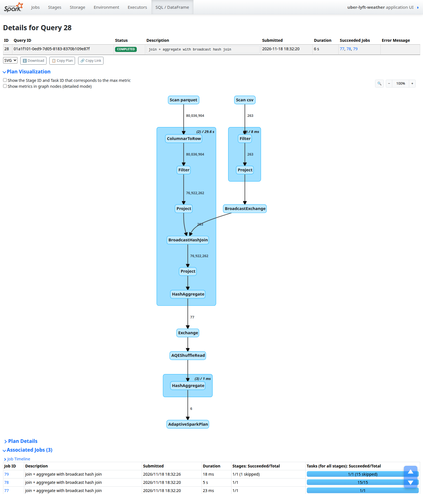
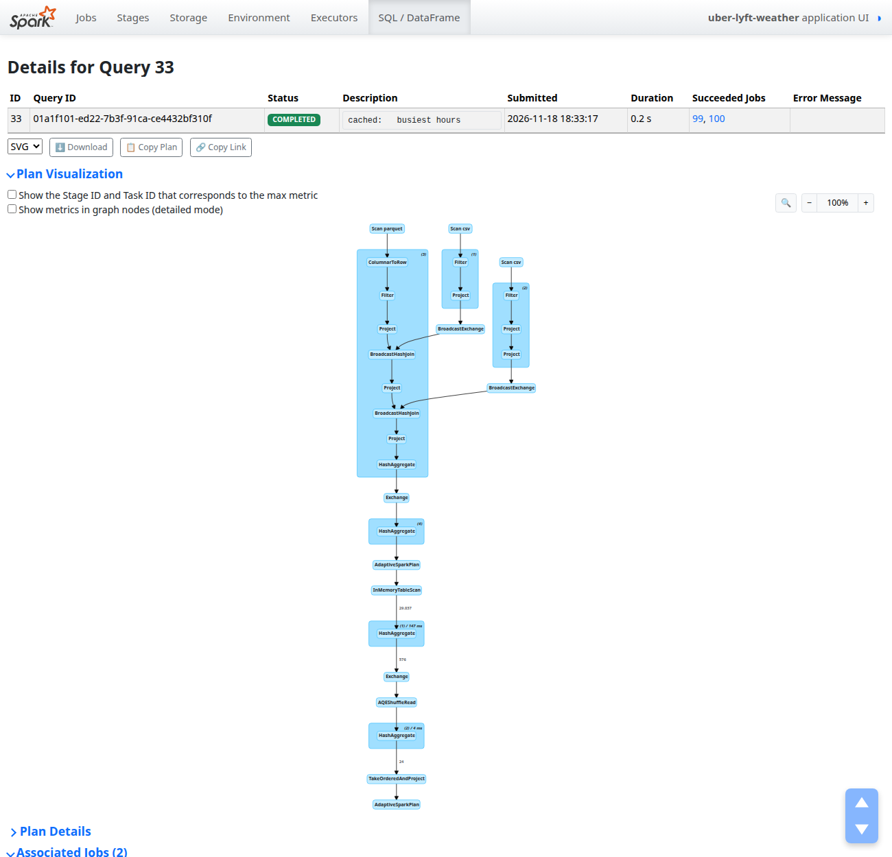
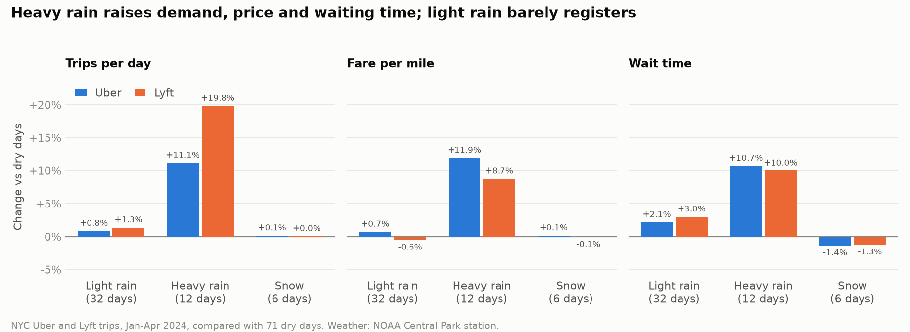

# Rain, Cold and Ride-Hailing: a PySpark pipeline on 80M Uber/Lyft trips

A PySpark pipeline that joins four months of New York City Uber and Lyft trips to daily weather and asks: **how does weather change ride-hailing demand, prices, waiting time and driver pay, and does it hit Uber and Lyft differently?**

| File | What it is |
|---|---|
| [`uber_lyft_weather_pipeline.ipynb`](uber_lyft_weather_pipeline.ipynb) | The executed notebook (all outputs included) |
| [`docs/uber_lyft_weather_pipeline.html`](docs/uber_lyft_weather_pipeline.html) | HTML export of the same notebook |
| [`pipeline.py`](pipeline.py) | The same code as a plain Python script (Jupytext percent format) |
| [`screenshots/`](screenshots) | Spark UI Query Details, execution plan and run screenshots |
| [`scripts/make_charts.py`](scripts/make_charts.py) | Draws the chart in `charts/` from the pipeline's result table |

## Dataset

| Dataset | Source | Format | Size |
|---|---|---|---|
| High Volume For-Hire Vehicle trip records, Jan-Apr 2024 | [NYC Taxi & Limousine Commission](https://www.nyc.gov/site/tlc/about/tlc-trip-record-data.page) | 4 Parquet files | 80,036,904 rows, 24 columns, 1.83 GB compressed |
| Taxi zone lookup | NYC TLC | CSV | 265 zones |
| Daily weather, Central Park (station USW00094728) | [NOAA GHCN-Daily](https://www.ncei.noaa.gov/products/land-based-station/global-historical-climatology-network-daily) | CSV | 1 row per day, 121 days used |

The trip records cover every Uber (`HV0003`) and Lyft (`HV0005`) trip in the city: request, pickup and drop-off times, pickup and drop-off zone, miles, duration, passenger fare, tips and driver pay. The study window has 71 dry days, 32 light-rain days, 12 heavy-rain days (10 mm or more) and 6 snow days.

The notebook downloads all three datasets itself on first run (about 1.85 GB), so `data/` is not in the repository.

## How to run

```bash
python -m venv .venv && source .venv/bin/activate
pip install -r requirements.txt          # needs Java 17 or 21
jupyter nbconvert --to notebook --execute --inplace uber_lyft_weather_pipeline.ipynb
jupyter nbconvert --to html --output-dir docs uber_lyft_weather_pipeline.ipynb
python scripts/make_charts.py            # optional: redraw the chart
```

Run time is about 7 minutes on a laptop (`local[6]`, 3 GB driver memory, Spark 4.3.0). The notebook also detects Databricks and switches to a Unity Catalog volume, but that path has not been run; on serverless compute `.cache()` and the Spark UI metrics helper are not available.

## Pipeline

| Step | What happens | Spark features |
|---|---|---|
| Load | Parquet trips, CSV zones (explicit schema), CSV weather | Parquet and CSV readers |
| Prune + filter | Keep 13 of 24 columns; date-range filter, data-quality filter, scope filter (private rides, known zone). 76,922,262 of 80,036,904 rows kept (96.1%) | Column pruning, early filtering |
| Transform | 10 `withColumn` steps: company, date, hour, weekend flag, wait time, fare per mile, driver share, tipped, speed | `withColumn`, built-in functions |
| Join | Trips to zones and to weather, both with `broadcast` hints | Broadcast hash joins, no shuffle |
| Aggregate | `groupBy(weather_type, company)` with 8 aggregates | `groupBy`, partial aggregation |
| SQL | 3 queries on a temp view, one with CTEs and a window function | Spark SQL, CTEs, window functions |
| Write | 76.9M enriched rows to Parquet, `partitionBy("pickup_month")`, plus 4 small result tables | Partitioned write |
| Extras | Lazy vs eager demo, cache timing, MLlib demand model | Lazy evaluation, `.cache()`, MLlib |

## Performance analysis

**How Spark optimized the query.** The main aggregation is written as a select, three filters, ten `withColumn` calls, two joins and a `groupBy`, but the [physical plan](screenshots/09_explain_physical_plan.png) shows Catalyst collapsing it into a single stage. It reads only 10 of the 24 columns, merges the three filters into one predicate, and uses a `BroadcastHashJoin` for both small tables, so the 77M trip rows are never shuffled for a join. A partial aggregation runs before the shuffle, which is why only 266 rows cross it ([Query Details](screenshots/03_query_details_main_aggregation.png)).

**Where filters were pushed down.** All three filters appear in `PushedFilters` on the Parquet scan, yet the Spark UI showed the scan still reading all 80M rows: the raw TLC files carry no min/max statistics, so the reader had nothing to skip with. On the pipeline's own output, which does have statistics, a filter on the stored `pickup_date` column read 3.4M of 76.9M rows, while the same filter written as `to_date(pickup_datetime)` could not be pushed and read every row ([skipped](screenshots/04_query_details_date_filter_skips_rows.png) vs [not skipped](screenshots/05_query_details_function_filter_reads_all.png)). `PushedFilters` shows what was offered to the reader; the scan's row count shows what was saved.

**Bottlenecks and optimizations.** The slowest step is the partitioned write (117 s, about a quarter of the run). Partitioning by month, which matches the input files, avoided a shuffle before the write and lets later queries prune whole folders. The second cost is that every action re-reads the source; caching a small hourly summary that three later queries and the ML model reuse removed that. Broadcasting the lookup tables instead of letting Spark sort-merge them was the other large saving.

| Optimization | Without | With |
|---|---|---|
| Broadcast join instead of sort-merge | 17.4 s | 5.6 s |
| Cache the hourly summary (3 follow-up queries) | 34.6 s | 0.7 s, plus 16.6 s to fill the cache |
| Filter on a stored DATE column instead of a function | 76.9M rows read | 3.4M rows read |
| Partition pruning on `pickup_month` (February only) | n/a | 0.6 s |

### Screenshots

| | |
|---|---|
| Pipeline run: all 53 queries completed, none failed |  |
| Jobs list |  |
| Physical plan from `.explain(mode="formatted")` |  |
| Query Details, main aggregation: broadcast joins, 80.0M rows scanned, 76.9M after filter, 266 into the shuffle |  |
| DATE filter: scan reads 3.4M rows |  |
| Function filter: scan reads all 76.9M rows |  |
| Sort-merge join: two extra shuffles and sorts |  |
| Broadcast join: no shuffle before the join |  |
| Cached query: starts from `InMemoryTableScan` |  |

## Key findings from the data



These are observational comparisons over 121 days with one daily weather reading for the whole city, so they show association, not cause.

1. **Heavy rain raises demand and price; light rain does not.** On the 12 heavy-rain days Uber carried 508,292 trips a day against 457,364 on dry days (+11%), and Lyft 201,716 against 168,386 (+20%). Fare per mile rose 12% on Uber ($7.31 to $8.18) and 9% on Lyft ($6.99 to $7.60). Light-rain days were within 1% of dry days on trips and price.
2. **Riders wait longer and trips are slower in heavy rain.** Average wait rose by about half a minute on both apps (Uber 4.20 to 4.65 min, Lyft 4.71 to 5.18 min) and average speed fell from 13.8 to 12.9 mph.
3. **On Uber, the rain premium did not reach drivers.** Comparing wet and dry weekdays, Uber's fare per mile rose 3.8% while average driver pay per trip fell from $19.78 to $19.46 and the driver's share of the fare fell from 77.3% to 75.8%. On Lyft the driver's share was flat to slightly up (76.4% to 76.8%).
4. **The rain effect is concentrated in a few busy districts and late at night.** The largest weekday uplifts were West Chelsea/Hudson Yards (+10.9%), Midtown Center (+9.6%), Borough Park (+10.6%) and Brooklyn Navy Yard (+12.4%); Staten Island showed none. By hour, the biggest gaps were at 1-2 am, where wet-day waits were 1.0 to 1.3 minutes longer and fare per mile 14-15% higher, against 2-3% higher at midday.
5. **Snow days look different.** On the 6 snow days trip counts matched dry days but the average fare was about 9% lower ($23.43 vs $25.60 on Uber). Six days is too few to read much into.
6. **Daily weather did not improve the demand model.** A gradient-boosted tree model predicting trips per borough per hour reached R² 0.969 (RMSE 752 on a mean of 5,210) from hour, day of week and borough alone. Adding rain and temperature made held-out days slightly worse (RMSE 808), which is consistent with finding 1: only the 12 heavy-rain days move demand, probably too few for the model to learn from.

Uber carried 72.9% of the 76.9M trips in the cleaned data.

## Limitations and next steps

- **Weather is one reading per day for the whole city.** A storm that lasts two hours is spread over 24. Hourly weather would sharpen every comparison and is the first thing to add.
- **121 days, winter to early spring.** There are only 12 heavy-rain days and 6 snow days, and no control for holidays or events.
- **Averages of ratios.** Driver share and fare per mile are averaged per trip, so short trips weigh as much as long ones.
- **Run locally only.** The notebook has a Databricks path that has not been run; on serverless compute `.cache()` and the Spark UI metrics helper are unavailable.
- **Source files have no statistics.** Rewriting the raw trips once, sorted by date, would let date filters skip row groups from the start.

## Data sources and licence

Trip records and the zone lookup are published by the [NYC Taxi & Limousine Commission](https://www.nyc.gov/site/tlc/about/tlc-trip-record-data.page). Weather observations come from [NOAA's Global Historical Climatology Network Daily](https://www.ncei.noaa.gov/products/land-based-station/global-historical-climatology-network-daily). Neither dataset is redistributed here. The code in this repository is released under the [MIT licence](LICENSE).
